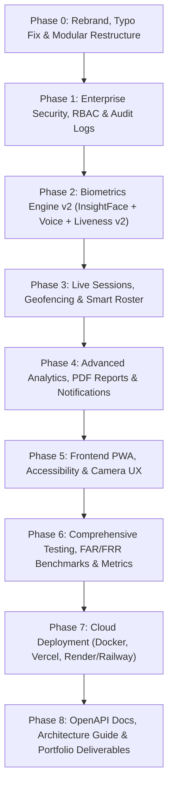

# Presence.ai — Architectural Roadmap & Master Implementation Plan

> **Role**: Principal Full-Stack & Applied ML Engineer  
> **System**: Presence.ai — Multi-modal Biometric Attendance & Academic Monitoring Platform  
> **Target Production Architecture**: FastAPI + React 19 (Vite + Tailwind) + Supabase (PostgreSQL) + dlib ResNet-128 / InsightFace + Resemblyzer GE2E

---

## 1. Executive Summary & Codebase Audit (What Exists)

### Current Architecture
- **Backend**:
  - Monolithic [`server.py`](server.py) hosting FastAPI routes, background tasks, static file mounting, rate limiting, and core endpoints.
  - Legacy directory spelling: `src/pipline/` (`face_pipline.py`, `voice_pipline.py`).
  - Database access layer: [`src/database/db.py`](src/database/db.py) directly calling Supabase client via [`src/database/config.py`](src/database/config.py).
  - Auth module: [`src/auth.py`](src/auth.py) implementing JWT access (15m) + refresh (7d) tokens with HTTP-only cookies and role dependencies (`require_teacher`, `require_student`).
- **Pipelines**:
  - **Face Recognition**: dlib frontal face detector (`dlib.get_frontal_face_detector()`), 68-point landmark shape predictor, ResNet-128 face descriptor, linear SVM + Euclidean distance thresholding.
  - **Liveness Anti-Spoofing**: 68-point facial landmark Eye Aspect Ratio (EAR) geometry thresholding (`ear > 0.16`).
  - **Voice Biometrics**: Resemblyzer GE2E neural speaker verification (256-d embeddings) using librosa 16kHz mono normalization and cosine similarity matching.
- **Frontend**:
  - React 19 SPA built with Vite and Tailwind CSS (`#09090b` dark zinc theme).
  - Portals: Faculty Portal (Subjects, 4 Attendance Modes, Review Drawer, Overrides, LMS CSV Export, Settings) & Student Portal (Face ID with liveness, Roll+PIN login, Biometric Enrollment, Plain-English Bunk & 75% Target Calculator).
  - Hardware camera lifecycle with black-frame / privacy shutter detection and microphone audio level meter.
- **Tests**:
  - 16 passing pytest suites in [`tests/`](tests/) (`test_auth.py`, `test_bunk_calculator.py`, `test_face_pipeline.py`, `test_voice_pipeline.py`).

---

## 2. Gap Analysis & What We Are Changing

```
Current State                               Target Production Architecture
-------------                               -----------------------------
server.py (all endpoints in one file)   ->  routers/ (auth, teacher, student, attendance, admin, settings)
src/pipline/ (typo in package name)     ->  src/pipeline/ (face_engine, voice_engine, liveness, detector)
Direct DB calls with raw dicts          ->  services/ (business logic) + schemas/ (Pydantic v2 validation)
Hardcoded config loading                ->  src/core/config.py (pydantic-settings with validation)
Teacher & Student roles only            ->  Role-based system: Admin, Teacher, Student
Raw DB logs only                        ->  Audit logging (audit_logs table with IP, user, timestamp, diff)
Single face photo reference             ->  Multi-sample face enrollment (3 angles: front, left, right) + InsightFace ONNX abstraction
Basic EAR liveness                      ->  Liveness v2: Active challenges (blink/head turn) + texture check
dlib only face detector                 ->  FaceEngine abstraction with dlib + RetinaFace/YuNet support
Session-less attendance                 ->  Live session system (rotating dynamic QR/code, live WebSocket/SSE counter)
Basic attendance stats                  ->  Rich visual analytics with Recharts, timetable scheduling, PDF reports
Standard web app                        ->  Installable PWA with offline shell, light/dark mode toggle
```

---

## 3. Risks & Mitigation Strategies

| Risk | Impact | Mitigation Strategy |
|---|:---:|---|
| **`pipline` -> `pipeline` renaming breaks imports** | High | Perform atomic refactoring with project-wide import search and run `pytest` immediately before moving to route extraction. |
| **dlib C++ build failure on cloud platforms** | High | Provide pre-built wheels (`dlib-bin`), Docker multi-stage caching, and architect `FaceEngine` so InsightFace / ONNX runtime can be hot-swapped without dlib. |
| **Cookie cross-site issues across origins (Vercel + Cloud Backend)** | Medium | Configure `SameSite=None; Secure=True` when running across distinct domains with `Access-Control-Allow-Credentials: true`, while keeping `SameSite=Lax; Secure=False` for local dev. |
| **Breaking database compatibility in Supabase** | High | Write non-destructive migrations using `IF NOT EXISTS` and backwards-compatible column defaults (`face_embedding`, `voice_embedding`, `pin`, `role`, `audit_logs`). |
| **Mobile camera restrictions over HTTP** | High | Document and automate Cloudflare Tunnel integration (`cloudflared`) to supply instant SSL/HTTPS for local mobile device testing. |

---

## 4. Phase-by-Phase Execution Roadmap



### Phase 0: Rebrand, Cleanup & Clean Architecture
- Rebrand name to **Presence.ai** uniformly across UI, title, favicon, SVG logo, and API metadata.
- Fix folder typo `src/pipline/` &rarr; `src/pipeline/` and update all imports.
- Modularize backend into:
  - `src/core/config.py` (Pydantic `BaseSettings`)
  - `src/schemas/` (Pydantic request/response models)
  - `src/services/` (auth service, attendance service, student service, teacher service)
  - `src/routers/` (`auth.py`, `teacher.py`, `student.py`, `attendance.py`, `admin.py`, `settings.py`)
- Clean up legacy code, add type hints, Ruff / Black config, and ESLint / Prettier config.

### Phase 1: Security & Auth Hardening
- Strengthen JWT: 15-min access token + 7-day refresh token in HTTP-only, Secure, SameSite cookies.
- Role-based dependencies: `Admin`, `Teacher`, `Student`.
- Password strength validation, account lockout after 5 consecutive failed attempts.
- Enforce mandatory PIN change on first login.
- `audit_logs` table tracking attendance changes, manual overrides, and biometric operations.
- Biometric privacy: store only vectors, consent checkbox, and GDPR-compliant "Delete my biometric data" endpoint.

### Phase 2: Biometrics Engine Upgrade
- Multi-sample face enrollment (3 angles: front, left, right) with weighted average embedding.
- Pluggable `FaceEngine` interface supporting dlib + InsightFace/ArcFace ONNX with runtime switch.
- Liveness v2: Active challenges (random blink / head turn) on top of EAR + texture check.
- Voice enrollment: 5-second MediaRecorder with real-time waveform level meter and strict silence/duration validation.
- Batch classroom photo/video tiling for small backbench faces.

### Phase 3: Smart Attendance & Live Sessions
- Teacher live session coordinator with rotating dynamic QR / 15-min passcode.
- Real-time attendance head-count streaming via Server-Sent Events (SSE) / WebSocket.
- Geofencing / Wi-Fi verification option.
- Anti-proxy multi-student device detection.
- Fast background processing via `BackgroundTasks`.

### Phase 4: Analytics, Visual Dashboards & Notifications
- Interactive attendance charts with Recharts (trends, weekday heatmaps, defaulter distribution).
- Administrator dashboard: system health, coverage %, active sessions.
- Notification dispatch (email alerts for < 75% shortfall).
- Multi-format exports: LMS CSV, Excel, and styled PDF reports with institutional header.

### Phase 5: PWA & Frontend Polish
- Progressive Web App (manifest.json, service worker, offline shell).
- Mobile-first camera UX (flip front/rear camera, live oval guide overlay, lighting warning).
- Light/Dark theme toggle (dark zinc default).
- React Query data fetching + Zod validation.

### Phase 6: Automated Testing, Benchmarking & FAR/FRR
- Pytest suite covering >70% of backend services.
- Vitest + React Testing Library for UI components.
- FAR / FRR evaluation script on synthetic sample distributions.
- `/health` and `/metrics` observability endpoints.

### Phase 7: DevOps, Containerization & HTTPS
- Optimized multi-stage `Dockerfile` with pre-cached dependencies.
- `render.yaml`, `railway.json`, and `frontend/vercel.json`.
- Cloudflare Tunnel one-command setup for mobile HTTPS testing.

### Phase 8: Documentation & Professional Portfolio
- Enterprise README with Mermaid architecture diagrams.
- `docs/ARCHITECTURE.md` and `docs/BIOMETRICS.md`.
- Interactive 2-minute demo mode with seeded sample records.
- Executive resume bullets and LinkedIn project blurb.

